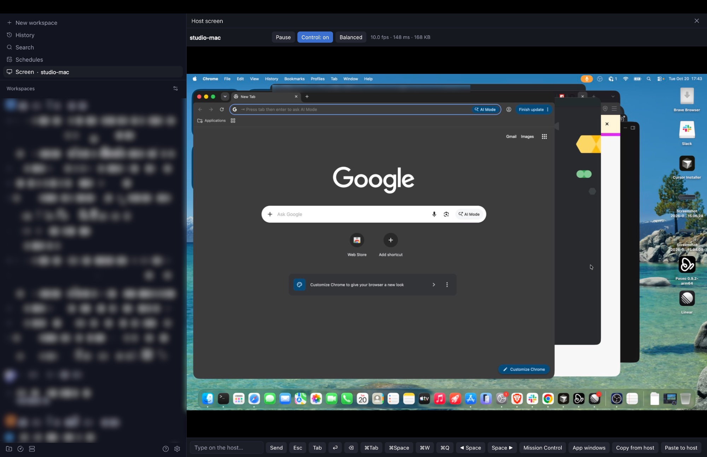
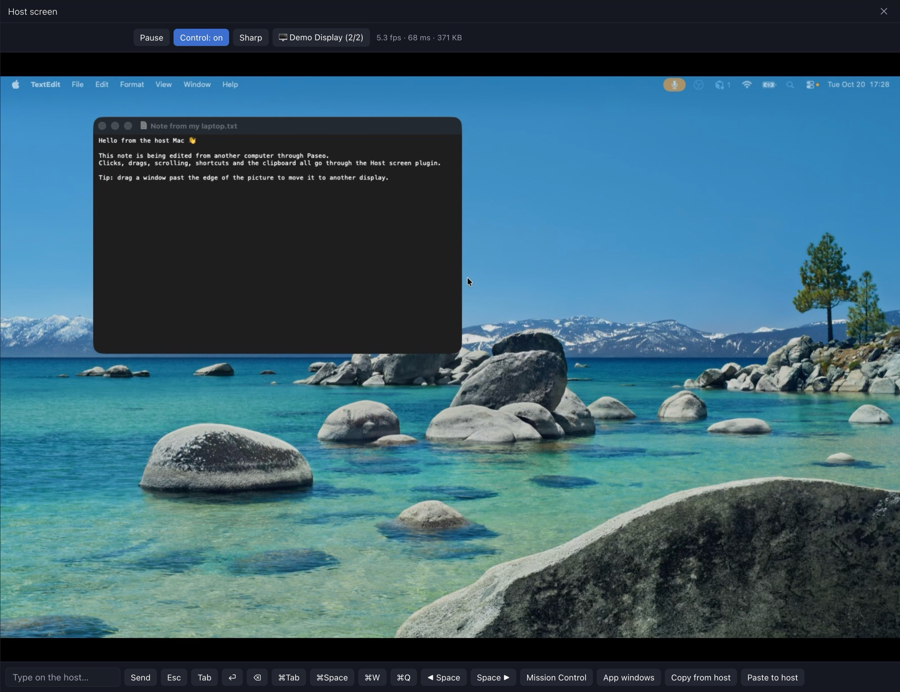
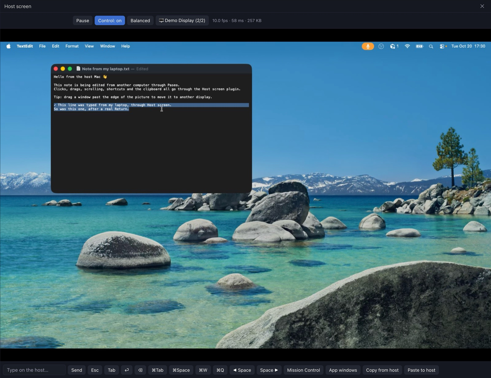

# Host screen for Paseo

A [Paseo](https://paseo.sh) plugin that lets you see and control the screen of the Mac or Linux computer (or, experimentally, Windows PC) running your Paseo daemon, from any paired Paseo client: the desktop app, the web app or your phone. Think of a small TeamViewer that rides on the Paseo connection you already have, relay included, so there is no port forwarding, VPN, VNC or extra account.

It was built for the moments when an agent on a remote machine needs a human: watching a Playwright run, clicking through a permission dialog, or checking what is actually on screen.



## Features

- Live view of the host's screen, sized to your viewer, at roughly 5 to 15 frames per second depending on the network.
- Mouse and keyboard control: click, double-click, right-click, drag, scroll and type.
- A key bar for shortcuts your own computer keeps for itself: ⌘Tab, ⌘Space, ⌘W, ⌘Q, switching Spaces (⌃←/⌃→), Mission Control and App windows on a Mac host; Super+Tab, Activities, Apps, Ctrl+W, Alt+F4 and switching workspaces on a Linux host.
- Two-way text clipboard on desktop and web clients. ⌘V pastes your clipboard on the host, and ⌘C on the host copies back to you. With a Linux host, use Ctrl from a Windows or Linux client; a Mac client's ⌘ works there too.
- Multiple displays: each one is listed by name, the last choice is remembered, and a drag that leaves the picture continues onto the neighbouring display.
- Phones: tap to click, long-press to right-click, pinch to zoom, drag to pan, and a Rotate button that turns the picture sideways.
- Wakes the host's display when you open the viewer, and shows the lock screen if the host is locked so you can type your password to unlock it.
- View-only mode, and Fast / Balanced / Sharp quality presets.





## Requirements

- A Mac host running macOS 14 or later, with the Xcode command line tools (`xcode-select --install`). The native helper is compiled with `swiftc` the first time it is used.
- Or a Linux host running an X11 desktop session (Wayland is not supported yet), with a C compiler and the X11 and JPEG development packages, including `libxtst-dev` (see Install, step 3). The native helper is compiled with `cc` the first time it is used.
- Or, **experimentally**, a Windows 10 or 11 host. The native helper is compiled with the .NET Framework's `csc.exe`, which Windows includes, so nothing needs installing. Windows support is built and reviewed but not yet tested on a real Windows host.
- Paseo 0.12 or later, with plugins enabled on the host.
- Any Paseo client paired with that host.

## Install

1. Enable plugins on the host by setting `"pluginsEnabled": true` in `~/.paseo/config.json`, then run `paseo reload`.
2. Install the plugin on the host from the [Paseo plugin directory](https://paseo.sh/plugins/kevguy/screen):

   ```bash
   paseo plugin add kevguy/screen
   # or straight from npm or GitHub
   paseo plugin add npm:@kevlai22/paseo-screen
   paseo plugin add git:kevguy/paseo-screen
   ```

3. Prepare the host:
   - **Mac:** open System Settings → Privacy & Security and turn on **Paseo** under both **Screen Recording** and **Accessibility**. Quit and reopen Paseo.
   - **Linux:** install a C compiler and the X11 and JPEG development packages. The helper is compiled from source the first time the screen opens, and the build fails without them. `libxtst-dev` is the one most desktops lack: it provides XTest, which the plugin uses to send mouse and keyboard input.

     ```bash
     # Debian or Ubuntu
     sudo apt install gcc libx11-dev libxext-dev libxtst-dev libxrandr-dev libxfixes-dev libjpeg-dev
     # Fedora
     sudo dnf install gcc libX11-devel libXext-devel libXtst-devel libXrandr-devel libXfixes-devel libjpeg-turbo-devel
     # Arch
     sudo pacman -S gcc libx11 libxext libxtst libxrandr libxfixes libjpeg-turbo
     ```

     Linux hosts on X11 need no permissions. Paseo has to run inside the desktop session, which is the case for the Paseo desktop app, so the helper can reach the display. Wayland sessions are not supported yet. A daemon started outside the desktop session with only `DISPLAY` set (for example a systemd unit with `DISPLAY=:0`) can end up on a Wayland desktop's XWayland server and show a black or partial picture.
   - **Windows (experimental):** nothing to prepare. Paseo has to run in the signed-in desktop session, as the Paseo desktop app does. Windows doesn't let normal apps see or control the lock screen, sign-in screen or UAC prompts, so those have to be handled at the PC, and apps running as administrator ignore input from the plugin.
4. In any Paseo client, open **Screen · _host name_** from the sidebar, or search "host screen" in the command center.

If a permission is missing on a Mac, the viewer says which one and offers a button that shows the macOS prompt on the host. Someone has to be at the host Mac to approve it once.

macOS gives these permissions to the app that started the Paseo daemon. That is normally the Paseo desktop app. If you run the daemon some other way, for example `paseo start` from a terminal, grant the permissions to that app (such as Terminal) instead.

## How it works

```
Paseo client (laptop, web, phone)                    Host (Paseo daemon)
  Host screen view  ── plugin RPC over Paseo relay ──▶  plugin server
   - polls screen.frame, two in flight                   ├─ helper #1: ScreenCaptureKit → JPEG
   - sends screen.input batches                          └─ helper #2: mouse and keyboard
                                                         macOS: ScreenCaptureKit and CGEvent
                                                         Linux: X11 (XShm, XTest, XRandR, XFixes) and libjpeg
```

- `helper/main.swift` (macOS), `helper/linux.c` (Linux) and `helper/windows.cs` (Windows, experimental) are small native helpers speaking the same line-delimited JSON. The plugin server embeds all three sources, compiles the one for its platform into `~/Library/Caches/paseo-screen/<hash>/` on macOS, `~/.cache/paseo-screen/<hash>/` on Linux or `%LOCALAPPDATA%\paseo-screen\<hash>\` on Windows, and runs two copies so input never waits behind a frame capture.
- The Windows helper captures each monitor with GDI and sends input with `SendInput`. Keys are pressed by scan code, so they match the physical positions the other hosts use; typed text arrives as Unicode, and a Mac client's ⌘ is sent as Ctrl.
- Input carries macOS key codes, which name physical key positions. The Linux helper presses the key in the same position, and treats `cmd` as the Super key. A Mac client's ⌘ is sent as Ctrl to a Linux host, so ⌘C, ⌘V and other shortcuts do what you expect there.
- macOS grants Screen Recording and Accessibility to Paseo as the responsible app, so rebuilding the helper does not need new permissions.
- Frames are JPEGs sized to the viewer. Unchanged frames come back without image data.
- The RPCs are defined in `shared/rpc.ts`: `screen.status`, `screen.request-permissions`, `screen.frame`, `screen.input`, `screen.clipboard` and `screen.choose-display`.

## Security

Anyone paired with the host can see and control its screen while the plugin is enabled. That is the same trust that pairing already grants for running agents and terminals on that machine. Traffic stays inside the Paseo connection; the plugin opens no ports and talks to no other service. View-only mode is a setting in each viewer, not a lock on the host: any paired client can still send input. Turn the plugin off with `paseo plugin disable paseo-screen` when you don't need it.

## Limitations

- Mac hosts and Linux hosts running X11 are supported; Wayland sessions are not yet. Windows hosts are experimental and untested. Any Paseo client can view. Linux support has been tested on an X11 session only. Recent GNOME releases have dropped their X11 session (Ubuntu 25.10 and Fedora 43 no longer offer one), so those hosts need a desktop that still runs on X11, such as Xfce, MATE or Cinnamon.
- On Linux, the key bar's Activities, Apps and workspace buttons use GNOME's default shortcuts, and lock-screen detection uses `gdbus` with the GNOME or freedesktop screensaver service. Other desktops still work, but those buttons may do nothing and the viewer may not say when the host is locked.
- On Linux, characters outside Latin-1 (such as Cyrillic, Greek or €), and any character the host's keyboard layout lacks, are typed by briefly remapping a spare key. That takes about 30 ms per character, so paste long non-Latin text instead of typing it. Pasting with Ctrl+V does not work in terminals; use Ctrl+Shift+V (⌘⇧V from a Mac).
- It is frame polling, not video. Fast motion looks choppy, and the frame rate depends on your link to the Paseo relay.
- Granting the two macOS permissions needs someone physically at a Mac host once.
- The plugin doesn't stop the host from sleeping or locking on its own schedule. Opening the viewer, using the mouse or keyboard on the picture, or the **Wake display** button wakes the display, and you unlock it by typing your password. Touch ID isn't available remotely.
- Shortcuts your own computer or the Paseo app handle first (⌘Tab, ⌘Space, ⌘W, ⌘Q) need the key bar buttons.
- Clipboard sync is text only, and only on desktop and web clients.
- Keys are sent by physical position, so both computers should use the same keyboard layout.
- No audio and no file transfer.

## Development

```bash
npm install
npm run typecheck   # also re-embeds helper/main.swift into server/helper-source.generated.ts
npm test            # rotate/zoom/pan math for the touch viewer
paseo plugin install "$PWD"           # once, from a checkout
paseo plugin reload paseo-screen      # after changes
paseo plugin logs paseo-screen
```

After editing `helper/main.swift` or `helper/linux.c`, run `npm run embed` (or `npm run typecheck`). The plugin bundle runs from memory, so the server can't read files next to itself and the helper source has to be embedded.

`scripts/` also has tools that call the plugin through a running daemon, using Paseo's CLI internals from an extracted copy of the Paseo app (`npx @electron/asar extract /Applications/Paseo.app/Contents/Resources/app.asar <dir>`):

- `rpc-probe.mjs <asar dir> <method> [json]` calls one RPC and saves frames to `build/probe-frame.jpg`.
- `frame-bench.mjs` and `pipeline-bench.mjs` measure frame latency and throughput, locally or through the relay.
- `compile-check.mjs` bundles the plugin with Paseo's own plugin compiler.

## License

[MIT](LICENSE)
